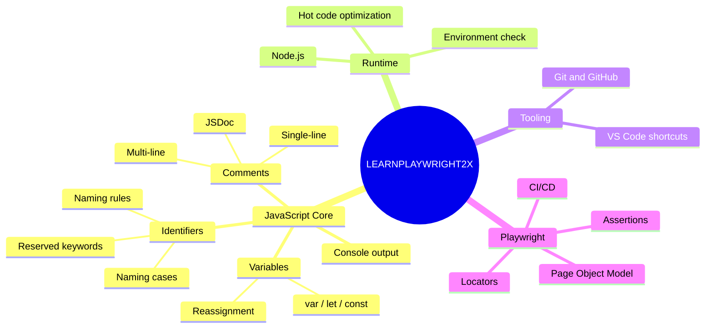
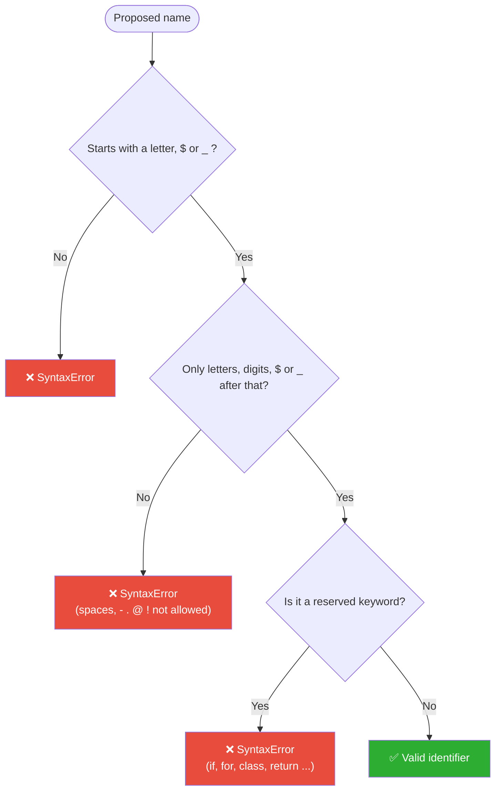
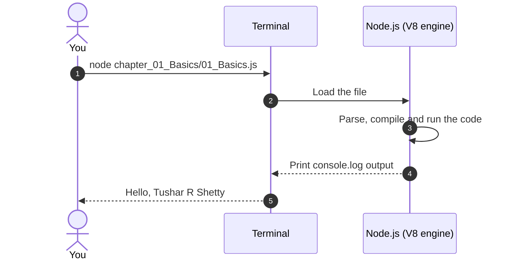

<div align="center">

# 🎭 LEARNPLAYWRIGHT2X

### From JavaScript fundamentals to production-grade test automation with Playwright


[Overview](#-overview) •
[Learning Path](#-learning-path) •
[Curriculum](#-curriculum) •
[Getting Started](#-getting-started) •
[Conventions](#-conventions) •
[References](#-quick-references)

</div>

---

## 📌 Overview

Reliable test automation depends on fluency in the language under it. This repository builds that base one step at a time. Every concept is shown in a small, runnable file before moving on to Playwright, so each tool is understood rather than copied.

> [!NOTE]
> Each chapter is self-contained and each file covers **one idea**. Every lesson runs on its own with `node <file>.js`. No build step and no dependencies are needed.

### 🎯 Learning Objectives

| | Objective |
|:---:|---|
| ⚙️ | Understand how JavaScript runs on **Node.js** and how to check the local setup |
| 📐 | Learn the language rules every test script relies on: **identifiers, literals, comments, variables** |
| 🏷️ | Use the **naming conventions** found in professional automation frameworks |
| 🎭 | Move on to **Playwright**: locators, assertions, Page Object Model, API testing and CI/CD |

---

## 🗺️ Learning Path

```mermaid
flowchart LR
    A["📘 JS Basics"] --> B["🧠 JS Concepts"]
    B --> C["🔤 Identifiers & Literals"]
    C --> D["🔢 Data Types & Operators"]
    D --> E["🔀 Control Flow"]
    E --> F["🧩 Functions & Scope"]
    F --> G["📦 Objects & Arrays"]
    G --> H["⏳ Async JavaScript"]
    H --> I["🎭 Playwright Fundamentals"]
    I --> J["🏗️ Framework Design"]

    classDef done fill:#2EAD33,stroke:#1e7a22,color:#fff
    classDef progress fill:#F7B731,stroke:#b8860b,color:#000
    classDef planned fill:#dfe4ea,stroke:#a4b0be,color:#2f3542

    class A done
    class B,C progress
    class D,E,F,G,H,I,J planned
```



<div align="center">

🟩 **Complete** &nbsp;&nbsp; 🟨 **In progress** &nbsp;&nbsp; ⬜ **Planned**

</div>

### 🧭 Topic Map



---

## 📚 Curriculum

### Progress Tracker

| # | Chapter | Progress | Status |
|:---:|---|---|:---:|
| 01 | Basics |  | ✅ Complete |
| 02 | JavaScript Concepts |  | 🟡 In progress |
| 03 | Identifiers & Literals |  | 🟡 In progress |
| 04 | Data Types & Operators |  | ⏳ Planned |
| 05 | Control Flow |  | ⏳ Planned |
| 06 | Functions & Scope |  | ⏳ Planned |
| 07 | Objects & Arrays |  | ⏳ Planned |
| 08 | Asynchronous JavaScript |  | ⏳ Planned |
| 09 | Playwright Fundamentals |  | ⏳ Planned |
| 10 | Framework Design |  | ⏳ Planned |

> [!TIP]
> Click a chapter below to expand its lessons, key takeaways and run commands.

<details open>
<summary><b>📘 Chapter 01 — Basics</b> &nbsp;✅</summary>

<br>

| File | Concept | Key Takeaway |
|---|---|---|
| [`01_Basics.js`](chapter_01_Basics/01_Basics.js) | `console.log` and the first variable | `console.log` prints output; `let` declares a variable |
| [`02_JS.js`](chapter_01_Basics/02_JS.js) | Loops, functions, block scope | A `let` inside a `for` loop is a separate variable from one outside it |
| [`03_JS_Verify_Setup.js`](chapter_01_Basics/03_JS_Verify_Setup.js) | Environment check | `process.platform`, `process.arch` and `process.version` describe the runtime |
| [`04_HotCode.js`](chapter_01_Basics/04_HotCode.js) | Hot code | Code that runs many times is optimized by the JS engine |

```bash
node chapter_01_Basics/03_JS_Verify_Setup.js
```

</details>

<details>
<summary><b>🧠 Chapter 02 — JavaScript Concepts</b> &nbsp;🟡</summary>

<br>

| File | Concept | Key Takeaway |
|---|---|---|
| [`05_JS_Basics.js`](chapter_02_Javascript_Concepts/05_JS_Basics.js) | Declaring and reassigning variables | A `var` can be given a new value at any time |

```bash
node chapter_02_Javascript_Concepts/05_JS_Basics.js
```

</details>

<details>
<summary><b>🔤 Chapter 03 — Identifiers & Literals</b> &nbsp;🟡</summary>

<br>

| File | Concept | Key Takeaway |
|---|---|---|
| [`06_Identifier_Rules.js`](chapter_03_Identifier_Literals/06_Identifier_Rules.js) | Valid identifiers | Names may use letters, digits, `$` and `_` |
| [`07_Identifier_Part2.js`](chapter_03_Identifier_Literals/07_Identifier_Part2.js) | Naming cases | camelCase, PascalCase, snake_case, UPPER_SNAKE_CASE and more |
| [`08_Comments.js`](chapter_03_Identifier_Literals/08_Comments.js) | Comments | Single-line, inline, multi-line and JSDoc |
| [`Identifier_Rules_Examples.js`](chapter_03_Identifier_Literals/Identifier_Rules_Examples.js) | All identifier rules | Valid and invalid cases, reserved keywords and a quiz |

```bash
node chapter_03_Identifier_Literals/Identifier_Rules_Examples.js
```

#### How JavaScript checks an identifier



#### Naming cases at a glance

| Case | Example | Used for | Valid JS name? |
|---|---|---|:---:|
| camelCase | `firstName` | Variables, functions | ✅ |
| PascalCase | `LoginPage` | Classes, Page Objects | ✅ |
| snake_case | `first_name` | Python, database columns, API data | ✅ |
| UPPER_SNAKE_CASE | `BASE_URL` | Constants | ✅ |
| kebab-case | `login-page.spec.js` | File names, CSS, URLs | ❌ |

</details>

<details>
<summary><b>⏳ Chapters 04–10 — Planned</b></summary>

<br>

- [ ] **04 · Data Types & Operators**: primitive types, `typeof`, arithmetic, comparison, logical operators
- [ ] **05 · Control Flow**: `if` / `else`, `switch`, loops, `break` / `continue`
- [ ] **06 · Functions & Scope**: declarations, arrow functions, closures, hoisting
- [ ] **07 · Objects & Arrays**: literals, destructuring, spread, built-in array methods
- [ ] **08 · Asynchronous JavaScript**: callbacks, Promises, `async` / `await`
- [ ] **09 · Playwright Fundamentals**: setup, locators, actions, assertions, auto-waiting
- [ ] **10 · Framework Design**: Page Object Model, fixtures, test data, reporting, CI/CD

</details>

---

## 📂 Repository Structure

<details>
<summary><b>Click to view the full folder tree</b></summary>

<br>

```text
LEARNPLAYWRIGHT2X/
├── 📁 chapter_01_Basics/
│   ├── 01_Basics.js                          # console.log and the first variable
│   ├── 02_JS.js                              # Loops, functions and block scope
│   ├── 03_JS_Verify_Setup.js                 # Checks platform, architecture and Node version
│   └── 04_HotCode.js                         # Hot code and engine optimization
│
├── 📁 chapter_02_Javascript_Concepts/
│   └── 05_JS_Basics.js                       # Declaring and reassigning variables
│
├── 📁 chapter_03_Identifier_Literals/
│   ├── 06_Identifier_Rules.js                # Valid identifier examples
│   ├── 07_Identifier_Part2.js                # Naming cases
│   ├── 08_Comments.js                        # Types of comments
│   ├── Identifier_Rules_Examples.js          # All rules with a quiz
│   ├── VS_Code_keyboard_shortcut_window.md   # VS Code shortcuts for Windows
│   └── VS_Code_keyboard_shortcut_mac.md      # VS Code shortcuts for macOS
│
└── 📄 README.md
```

</details>

---

## 🚀 Getting Started

### Prerequisites

| Tool | Version | Purpose | Check with |
|---|---|---|---|
| [Node.js](https://nodejs.org/) | 18 LTS or later | Runs JavaScript outside the browser | `node --version` |
| [Visual Studio Code](https://code.visualstudio.com/) | Latest | Code editor | `code --version` |
| [Git](https://git-scm.com/) | Latest | Version control | `git --version` |

### How a lesson runs



### Setup in three steps

**1️⃣ Clone the repository**

```bash
git clone https://github.com/Tush783/LEARNPLAYWRIGHT2X.git
cd LEARNPLAYWRIGHT2X
```

**2️⃣ Verify your environment**

```bash
node chapter_01_Basics/03_JS_Verify_Setup.js
```

<details>
<summary>Expected output (values depend on your machine)</summary>

```text
win32
x64
Node Version: v25.9.0
```

</details>

**3️⃣ Run any lesson**

```bash
node <chapter_folder>/<file_name>.js
```

> [!IMPORTANT]
> Some examples that would throw an error are **commented out on purpose**, so the file still runs. Remove the `//` in front of one to see the error yourself.

---

## 📏 Conventions

| Element | Convention | Example |
|---|---|---|
| 📁 Chapter folders | `chapter_NN_Topic_Name` | `chapter_03_Identifier_Literals` |
| 📄 Lesson files | `NN_Topic.js`, numbered in reading order | `08_Comments.js` |
| 🔡 Variables & functions | camelCase | `loginButton`, `clickSubmit()` |
| 🏛️ Classes / Page Objects | PascalCase | `LoginPage` |
| 🔒 Constants | UPPER_SNAKE_CASE | `BASE_URL` |

> [!TIP]
> Read each file from top to bottom. Comments explain *why* the code works, not only *what* it does.

---

## 🔗 Quick References

<table>
<tr>
<td align="center" width="25%">

**⌨️ VS Code — Windows**<br>
[Open shortcuts](chapter_03_Identifier_Literals/VS_Code_keyboard_shortcut_window.md)

</td>
<td align="center" width="25%">

**⌨️ VS Code — macOS**<br>
[Open shortcuts](chapter_03_Identifier_Literals/VS_Code_keyboard_shortcut_mac.md)

</td>
<td align="center" width="25%">

**📖 MDN JavaScript**<br>
[Read the guide](https://developer.mozilla.org/en-US/docs/Web/JavaScript/Guide)

</td>
<td align="center" width="25%">

**🎭 Playwright Docs**<br>
[Read the docs](https://playwright.dev/docs/intro)

</td>
</tr>
</table>

<details>
<summary><b>⚡ The five shortcuts used most in these lessons</b></summary>

<br>

| Action | Windows | macOS |
|---|---|---|
| Toggle line comment | `Ctrl + /` | `⌘ /` |
| Toggle block comment | `Shift + Alt + A` | `⇧ ⌥ A` |
| Open terminal | `` Ctrl + ` `` | `` ⌃ ` `` |
| Format document | `Shift + Alt + F` | `⇧ ⌥ F` |
| Markdown preview | `Ctrl + Shift + V` | `⇧ ⌘ V` |

</details>

---

## 👤 Author

<table>
<tr>
<td>

**Tushar R Shetty**<br>
QA Engineer moving from manual testing into test automation.

[](https://github.com/Tush783)

</td>
</tr>
</table>

> [!NOTE]
> If this repository helps you, consider giving it a ⭐. It helps others find it.

---

<div align="center">

<sub><i>Learn the language first, then the framework.</i></sub>

</div>
