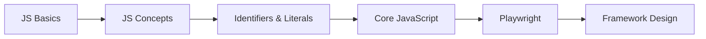

# LEARNPLAYWRIGHT2X

A step-by-step path from JavaScript fundamentals to test automation with Playwright.


---

## Overview

Good automation starts with a solid grasp of the language behind it. This repository covers JavaScript one concept at a time, with each idea in a small, runnable file, before moving on to Playwright.

Each file covers one idea and runs on its own with Node.js. No setup beyond Node is needed.

---

## Learning Path



---

## Curriculum

| # | Chapter | Topics | Status |
|:---:|---|---|:---:|
| 01 | [Basics](chapter_01_Basics/) | Console output, variables, loops, functions, environment check, hot code | ✅ Complete |
| 02 | [JavaScript Concepts](chapter_02_Javascript_Concepts/) | Declaring and reassigning variables | 🟡 In progress |
| 03 | [Identifiers & Literals](chapter_03_Identifier_Literals/) | Identifier rules, reserved words, naming cases, comments | 🟡 In progress |
| 04 | Data Types & Operators | Primitive types, `typeof`, operators | ⏳ Planned |
| 05 | Control Flow | `if` / `else`, `switch`, loops | ⏳ Planned |
| 06 | Functions & Scope | Arrow functions, closures, hoisting | ⏳ Planned |
| 07 | Objects & Arrays | Destructuring, spread, array methods | ⏳ Planned |
| 08 | Asynchronous JavaScript | Promises, `async` / `await` | ⏳ Planned |
| 09 | Playwright Fundamentals | Locators, actions, assertions | ⏳ Planned |
| 10 | Framework Design | Page Object Model, fixtures, reporting, CI/CD | ⏳ Planned |

<details>
<summary><b>View all lesson files</b></summary>

<br>

```text
LEARNPLAYWRIGHT2X/
├── chapter_01_Basics/
│   ├── 01_Basics.js                          # console.log and the first variable
│   ├── 02_JS.js                              # Loops, functions and block scope
│   ├── 03_JS_Verify_Setup.js                 # Checks platform, architecture and Node version
│   └── 04_HotCode.js                         # Hot code and engine optimization
│
├── chapter_02_Javascript_Concepts/
│   └── 05_JS_Basics.js                       # Declaring and reassigning variables
│
├── chapter_03_Identifier_Literals/
│   ├── 06_Identifier_Rules.js                # Valid identifier examples
│   ├── 07_Identifier_Part2.js                # Naming cases
│   ├── 08_Comments.js                        # Types of comments
│   ├── Identifier_Rules_Examples.js          # All identifier rules with a quiz
│   ├── VS_Code_keyboard_shortcut_window.md   # VS Code shortcuts for Windows
│   └── VS_Code_keyboard_shortcut_mac.md      # VS Code shortcuts for macOS
│
└── README.md
```

</details>

---

## Getting Started

**Prerequisites:** [Node.js](https://nodejs.org/) 18 or later, [VS Code](https://code.visualstudio.com/) and [Git](https://git-scm.com/).

```bash
# 1. Clone the repository
git clone https://github.com/Tush783/LEARNPLAYWRIGHT2X.git
cd LEARNPLAYWRIGHT2X

# 2. Verify your setup
node chapter_01_Basics/03_JS_Verify_Setup.js

# 3. Run any lesson
node chapter_03_Identifier_Literals/07_Identifier_Part2.js
```

> [!NOTE]
> Examples that would throw an error are commented out on purpose, so each file still runs. Remove the `//` in front of one to see the error.

---

## Conventions

| Element | Convention | Example |
|---|---|---|
| Chapter folders | `chapter_NN_Topic_Name` | `chapter_03_Identifier_Literals` |
| Lesson files | Numbered in reading order | `08_Comments.js` |
| Variables & functions | camelCase | `loginButton` |
| Classes / Page Objects | PascalCase | `LoginPage` |
| Constants | UPPER_SNAKE_CASE | `BASE_URL` |

---

## References

- VS Code shortcuts: [Windows](chapter_03_Identifier_Literals/VS_Code_keyboard_shortcut_window.md) · [macOS](chapter_03_Identifier_Literals/VS_Code_keyboard_shortcut_mac.md)
- [MDN JavaScript Guide](https://developer.mozilla.org/en-US/docs/Web/JavaScript/Guide)
- [Playwright Documentation](https://playwright.dev/docs/intro)

---

## Author

**Tushar R Shetty** · QA Engineer moving from manual testing into test automation · [GitHub](https://github.com/Tush783)
